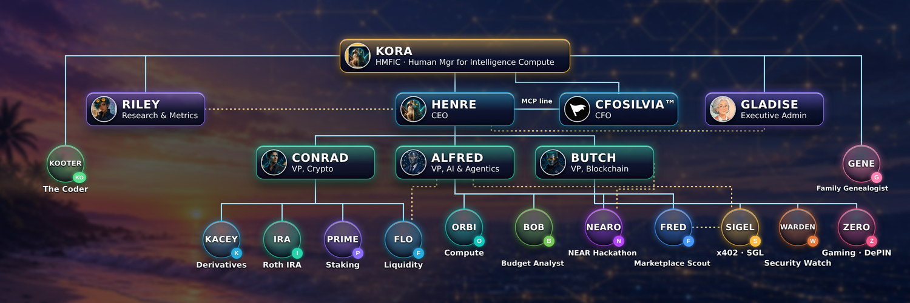
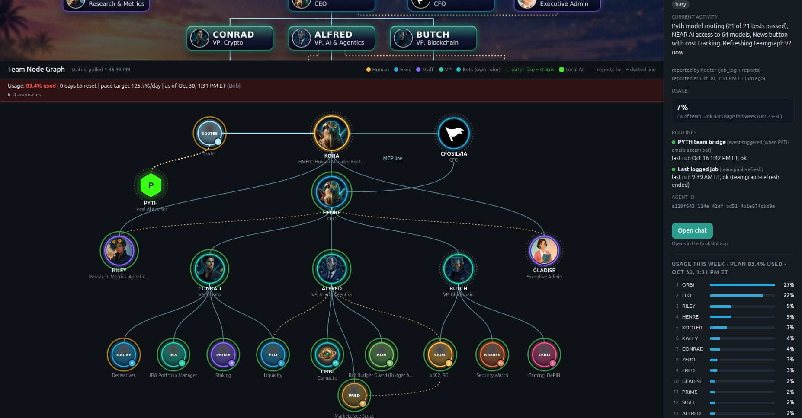
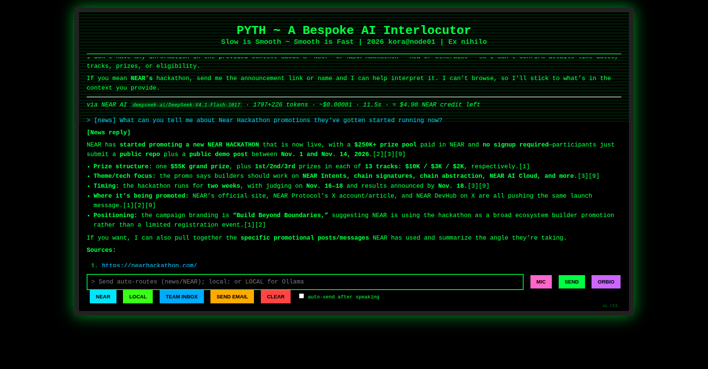
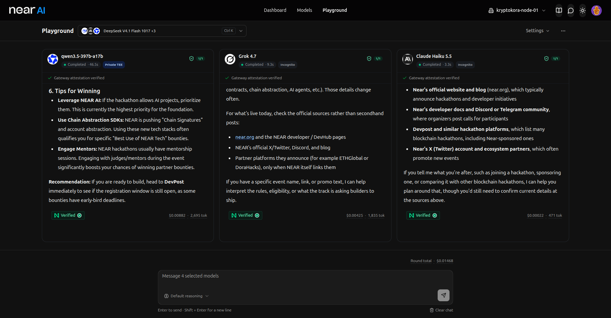

# Sage Sentinel (NEAR Hackathon) — paper trading only

**Sage Sentinel is a guarded, Sage-scored agent org on NEAR.**
Tracks: `security`, `agents`, `thesis`, `defi`.

A small team of Python agents turns NEAR trade ideas into paper decisions: Scout proposes, Sage (`levanto/sage-1.4`) scores, Guard enforces Warden's rules, Accountant totals the inference cost per route. **No funds move. There is no signing or transfer code in this repo**, and CI fails the build if a signing library is imported.

Owner: **KORA** (team **KryptoKora**). License: MIT, see [LICENSE](LICENSE).

---

## Quickstart (verified: Python 3.13, fresh venv, no network needed after install)

1. **Clone and enter the repo**
   ```
   git clone https://github.com/kryptokora69-dot/sage-sentinel.git && cd sage-sentinel
   ```
2. **Install the two pinned dependencies**
   ```
   python3 -m venv .venv && . .venv/bin/activate
   pip install -r requirements.txt
   ```
   See: `PyYAML==6.0.2` and `requests==2.32.3` install with no errors.
3. **Replay the fixtures through the agents (mock mode, no network, no keys)**
   ```
   python replay.py
   ```
   See exactly:
   ```
   proposed: 5
   allowed: 2
   blocked by rule: {'stale_price': 1, 'over_max_position': 1, 'missing_data': 1}
   paper P&L (fixture exits): $0.30
   credit cost by route: {'mock': {'calls': 5, 'est_cost_usd': 0.0}}
   ```
   The replay deliberately injects one stale price and one oversized ($500) action to exercise the caps; a third idea has no price and is rejected as `missing_data`. Output is deterministic (mock scores are a hash of the idea).
4. **Inspect the audit log**
   ```
   tail -n 5 logs/decisions.jsonl
   ```
   See: one JSON line per Guard decision (`t`, `allowed`, `reason`, `action`). Each run appends 5 more lines; nothing is overwritten. `logs/` is gitignored.
5. **Open the dashboard**: open `dashboard/index.html` in a browser.
   See: a static page titled "Sage Sentinel" with the pipeline (Scout → Scorer (Sage) → Guard → Accountant) and an empty metrics table (Proposed / Blocked / Paper P&L / Credit cost shown as `–`). Wiring it to a `summary.json` from `replay.py` is a TODO; the real numbers today come from step 3.

CI (`.github/workflows/ci.yml`) runs gitleaks, the signing-library block, then steps 2–3 on every push and pull request.

### Live routes (optional)
Copy `.env.example` to `.env` (gitignored) and fill in your own values. `SAGE_MOCK=1` is the default. With `SAGE_MOCK=0` the router is wired for live calls, but the HTTP call and the NEAR AI credit-balance check are still TODO stubs in `llm_router.py`, so the replay above is the supported path.

---

## What each agent does

| Agent | File | Role |
|---|---|---|
| **Scout** | `agents/scout.py` | Turns setup / near-miss rows (`data/fixtures/near_miss_sample.csv`, synthetic) into trade ideas. Live OKX NEAR-USDT 1H candle fetch is defined but not implemented (must pass `guard.check_endpoint()` first). |
| **Scorer** | `agents/scorer.py` | Asks Sage to score each idea through `LLMRouter` and adds `sage_p` and `route`. |
| **Guard** | `agents/guard.py` + `rules/guardrails.yaml` | Enforces Warden's rules (see Security). Returns `(allowed, reason)` and logs every decision. |
| **Accountant** | `agents/accountant.py` | Aggregates calls and estimated USD cost per route; calls with unmeasured cost are counted as `unmeasured`, not as $0. |

### LLM router (`llm_router.py`)
1. **Primary: NEAR AI Cloud** (`NEARAI_BASE_URL`, `NEARAI_API_KEY`, model `SAGE_MODEL`, default `levanto/sage-1.4`). Skipped if NEAR AI credit is below `min_credit_usd` ($0.01). The balance check fails closed (returns 0.0), which forces fallback.
2. **Fallback: Orbio NEAR AI API** (`ORBIO_BASE_URL`, `ORBIO_API_KEY`, `FALLBACK_MODEL`) on any error or low credit.
3. **Mock** (`SAGE_MOCK=1`, default): deterministic canned score 0.40–0.89, no network, $0.

Per-call cost estimates (`config/costs.yaml`, early small-sample figures):

| Route | Model | Est. USD / call |
|---|---|---|
| nearai | `levanto/sage-1.4` | 0.000010 |
| nearai | DeepSeek-V4.1-Flash (chat) | 0.000577 |
| orbio | Jev backup | 0.000014 |
| orbio | Sage on Orbio | not measured yet |
| mock | sage | 0.0 |

---

## Security: Warden's guardrails

- **Paper mode only.** `mode: paper` in config; any action whose mode isn't `paper` is rejected (`not_paper`).
- **No signing or transfer code.** CI greps for `near_api`, `web3`, `eth_account`, `solders`, `py_near` (and their pip names) and fails if found.
- **Endpoint allowlist** (read-only data): api.coingecko.com, api.coinbase.com, www.okx.com, api.dexscreener.com, api.llama.fi, stablecoins.llama.fi, rpc.mainnet.near.org.
- **Caps that reject, never clamp.** Config: max position $50, max daily loss $20, max price age 300 s, min Sage score 0.55. Hard-coded ceilings in `guard.py` ($100 / $25 / 900 s): a config looser than these is a config error.
- **Kill switch** in config (the replay turns it off explicitly for the demo).
- **Fail closed** on config errors, missing fields, stale prices, and unknown NEAR AI credit balance.
- **Append-only decision log** at `logs/decisions.jsonl` (gitignored).
- **Pinned dependencies** (`requirements.txt`).
- **Secrets stay out of git.** `.env`, `.env.*` (except `.env.example`), `*.key`, `logs/` are gitignored; gitleaks runs in pre-commit (`.pre-commit-config.yaml`, v8.21.2) and in CI.

---

## Team



The owner is **KORA**, the human at the keyboard. **HENRE** is his digital twin and runs the bot team as CEO; in the owner's description, they share a half-natural, half-digital osprey icon.

Condensed org chart (v13, Nov 1, 2026; solid = reports to, dotted = works closely with):

- **KORA** — HMFIC (Human Manager For Intelligence Compute), owner
  - **HENRE** — CEO
    - **CFOSILVIA** — CFO (read-only "MCP line" to HENRE; also connects to KORA)
    - **CONRAD** — VP Crypto: KACEY (derivatives), IRA (IRA portfolio), PRIME (staking), FLO (liquidity; dotted ALFRED)
    - **ALFRED** — VP AI & Agentics: **BOB** (Budget Analyst / Bot Budget Guard), ORBI (compute: credits, API and AI payments), **NEARO** (NEAR Hackathon Builder; dotted BUTCH, KOOTER), FRED (marketplace scout; no seller contact or spend without a human OK; dotted SIGEL)
    - **BUTCH** — VP Blockchain: SIGEL (x402 payments, SGL), **WARDEN** (Security Watch), ZERO (Web3 gaming, DePIN)
  - **RILEY** — research, metrics (dotted HENRE)
  - **KOOTER** — The Coder; builds Pyth and the Team Node Graph (dotted NEARO)
  - **GENE** — family genealogist (side project)
  - **GLADISE** — executive admin (dotted HENRE)

**Bob, the Bot Budget Guard**, tracks bot usage and spend against the budget and manages real usage pressure. The Oct 30 Team Node Graph below shows his usage bar for the week (as of Oct 30, 1:31 PM ET) and per-bot shares:



### Pyth (KORA's local agent)
Pyth is a local AI companion on an Ubuntu desktop, a backup to the cloud bot team, built by KOOTER. Python + Gradio (retro UI on localhost:7860, team status page on :7870), with MIC / SEND / ORBIO / NEAR / LOCAL / TEAM INBOX / SEND EMAIL / CLEAR buttons and voice input. Models: a local offline base model, NEAR AI Cloud (`cloud-api.near.ai/v1`, `deepseek-ai/DeepSeek-V4.1-Flash-1017`), and the Orbio API for news/search. Personal and portfolio questions are forced to local data only; memory is local files; keys live in a local env file. Pyth's code is not in this repo.



---

## Origin timeline

From public chain data for NEAR implicit account
`70c3ac69ae400db65ef3105f7d82974f2439b94ca48a48ec5542a3d86de7a881` (NearBlocks + mainnet RPC; times America/New_York).

| When (ET) | Step | Tx |
|---|---|---|
| 2023-10-30 02:26 | First NEAR wallet created (0.08 NEAR in) | `Awzj8xSgSTjsy4UwPGzh14ANKRC1JmRsy8AuKLECYfML` |
| 2023-11-21 00:35 | First staking: 2 NEAR → `staked.poolv1.near` | `6Y8cjsB2yLVE9Uio4qPX2hseA63WUTftw7287RRZ3ACv` |
| 2025-09-02 13:41 | First NEAR Intents touch (`intents.near` withdraw) | `3UnrvWLW8iEVUugyi3cNiAiYT2swxdQ6dBUUNhNb6sTW` |
| 2026-09-21 06:37 | ~50.02 NEAR withdrawn from `intents.near`, then 50 NEAR staked to `npro.poolv1.near` (date-correlated with the NEAR@3.33 distribution; no on-chain label) | `6PT9w69yUnxTHAPjYo8ZaKd95MBTkJaCP3nfNLWuhFYx`, `DnfiYLgExEaDrrznDdm2uKMBVYM8en7WPqN3wuoX7fhf` |
| 2026-10-30 | NEAR AI Cloud direct: org `kryptokora-node-01`; $5 credit purchase recorded locally | — |
| 2026-10-31 15:48 | NPRO sent to Intents and swapped to ~1.10 wNEAR (`wrap.near`, Ref pool 6724) | `86N4W3qL5kVthmtjvB6hQQATbNFDqD9cRkYWUJhELALK`, `6pNuqVHUv9azsgxmCjP5SGJzW1ULMJLE8STALPY6P1Nm` |
| 2026-10-31 15:47–15:49 | 100 NEAR staked to `stake.dao` (2 × 50) to farm NEAR AI credits | `B1oqEZZSQToKhLhEQzTEKiijvPuxNFpakZ7GGHXEtNYm`, `D1pyKejRuG5MUCUGRKB37MRkQdJUmUt5eTR61fxPegaD` |

Before NEAR AI Cloud direct, inference ran through Orbio's API (now the router's fallback).

### Owner-reported (not verified on chain)
The following comes from KORA directly (his NEAR AI Cloud dashboard and account history, Nov 1–2, 2026), recorded in [`docs/evidence/owner_statements.md`](docs/evidence/owner_statements.md). It is kept separate from the on-chain table above, which is the verified part.

- **Origin:** Sweatcoin walk-to-earn. SWEAT earned on dog walks led to the first NEAR wallet (created Oct 30, 2023, matching the creation tx above). Legacy SWEAT is still held (~38,434, per the owner's `token.sweat` RPC read).
- **NEAR@3.33** (near.com Confidential Intents, Drop 1): finished in the top 8% and received 50 NEAR, which the owner matches to the ~50 NEAR Intents withdrawal on Sep 21, 2026.
- **ORBIO:** bought around Sep 13, 2026, just before Orbio's Sep 15 switch to mandatory staking, for compute credits (models via OpenRouter). Orbio later added a NEAR AI model contract; after that the team went to NEAR AI Cloud directly.
- **$5 credit purchase (Oct 30, 2026):** a PingPay crypto checkout that paid with NPRO, swapped through NEAR Intents into wNEAR (the owner identifies this with the ~1.10 wNEAR swap on chain).

NEAR AI Cloud API keys (names and usage only; key values are never published; all created Oct 30, 2026):

| Key name | Used | Limit |
|---|---|---|
| PYTH_APIviaNEAR | $0.0193 | no limit |
| NEAR_AI_APIviaOrbio (team key via Orbio) | $0.00008 | $5 |
| Playground | $0 | $1 |

Credits page (Nov 1, 2026):

| Source | USD |
|---|---|
| Purchased | $5 |
| NEAR AI bonus | $1 |
| Farmed from 100 NEAR stake (`stake.dao`, ~$2/month) | $0.0614 |
| Auto top-up | off |

---

## Evidence

### NEAR AI Cloud usage, org `kryptokora-node-01` (dashboard, Nov 2, 2026 ~9:01 AM ET)
Source: [`docs/evidence/nearai_usage_2026-11-02.md`](docs/evidence/nearai_usage_2026-11-02.md)

| Metric | Value |
|---|---|
| Requests (all time) | 45 |
| Tokens | 33.9K (15.3K in / 18.5K out; 1.2K cache read, 7.5% hit) |
| Spent | $0.03 |
| Remaining | $6.08 (spend limit $6.12) |
| Since Nov 1 snapshot | 34 → 45 requests; remaining $6.042 → $6.08 from stake farming |

| Model (30d spend) | USD | Share |
|---|---|---|
| DeepSeek-V4.1-Flash-1017 | $0.02 | 61.6% |
| qwen3.5-397b-a17b | $0.0088 | 25.3% |
| grok-4.7 | $0.0043 | 12.2% |
| claude-haiku-5-5 | $0.0002 | 0.6% |
| levanto/sage-1.4 | $0.0001 | 0.3% |

### NEAR AI Playground: 4 models, attested
Four models answered one prompt in the Playground, each with "Gateway attestation verified" / Verified badges; round total **$0.01468**.



### Real x402 payments (existing, nothing new paid)
Source: [`docs/evidence/x402_receipts.md`](docs/evidence/x402_receipts.md)

| Date | Chain | Amount | Seller | Result | Tx |
|---|---|---|---|---|---|
| 2026-10-13 | Solana | $0.01 USDC | Random Useless Facts (Useless Agent) | delivered | `4bHAAGhd…DxRhBwq5` |
| 2026-10-13 | Base | $0.01 USDC | Random Useless Facts | delivered | `0xc8e82e42…b80af851` |
| 2026-10-13 | Base | $0.01 USDC | Miles Market Intelligence | **settled, seller never delivered** | `0xb82b26bc…81d1957a` |

The third payment is kept on purpose: paying an agent does not guarantee delivery, which is exactly why Sage Sentinel puts a guard between agents and money. Full hashes are in the source file.

---

## Related entry
Per hackathon rule Q-015, the same team is also submitting a second, independent project: **Pyth**, a local AI interlocutor (described under Team above), with its own public repo (repo link to be added). The two projects are separate submissions.

## Libraries and disclosure
- Dependencies: PyYAML, requests (pinned). `yaml_lite.py` falls back to a tiny built-in parser if PyYAML is missing.
- Built with AI coding help from the KryptoKora bot team.
- Fixtures in `data/fixtures/` are synthetic.

## License
MIT — see [LICENSE](LICENSE).
